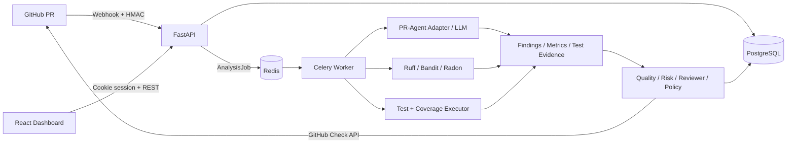
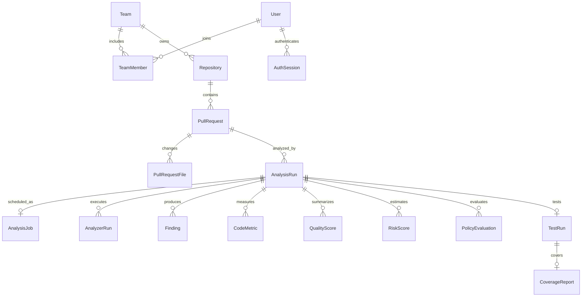

# CodeGate · Technical Handbook

> **Nền tảng phân tích chất lượng Pull Request, tổng hợp bằng chứng và hỗ trợ quyết định review.**
>
> Tài liệu kỹ thuật bằng tiếng Việt · Rà soát ngày **18/10/2026** · Dành cho chạy dự án, bảo vệ đồ án, giới thiệu portfolio và chuẩn bị phỏng vấn.

| Thông tin | Giá trị |
|---|---|
| Mã nguồn gốc của bản rà soát | [NV-DuyManh/CodeGate](https://github.com/NV-DuyManh/CodeGate) |
| Commit xuất phát | `30a0d1632aa313a9f202bc7c0fe7e4cb3dd1c4dd` |
| Nhánh sửa tại máy | `fix/codegate-runtime-ci-docs` |
| Phạm vi | Sửa lỗi có thể tái hiện, bổ sung kiểm thử và mô tả đúng hành vi hiện tại |
| Nền tảng kế thừa | PR-Agent; giữ nguyên ghi nhận tác giả và giấy phép trong repository |
| Trạng thái phát hành | Nhánh fix/codegate-runtime-ci-docs; có kiểm tra tại máy, chưa triển khai dịch vụ |

## Mục lục

1. [Dự án giải quyết vấn đề gì?](#1-dự-án-giải-quyết-vấn-đề-gì)
2. [Kiến trúc và công nghệ](#2-kiến-trúc-và-công-nghệ)
3. [Luồng phân tích một Pull Request](#3-luồng-phân-tích-một-pull-request)
4. [Cấu trúc mã nguồn](#4-cấu-trúc-mã-nguồn)
5. [Mô hình dữ liệu](#5-mô-hình-dữ-liệu)
6. [Quality, Risk và Policy](#6-quality-risk-và-policy)
7. [API và dashboard](#7-api-và-dashboard)
8. [Chạy và cấu hình](#8-chạy-và-cấu-hình)
9. [Các lỗi đã xử lý](#9-các-lỗi-đã-xử-lý)
10. [Bằng chứng kiểm tra](#10-bằng-chứng-kiểm-tra)
11. [Kịch bản demo](#11-kịch-bản-demo)
12. [Giới hạn và việc cần làm tiếp](#12-giới-hạn-và-việc-cần-làm-tiếp)
13. [Trình bày trong CV và phỏng vấn](#13-trình-bày-trong-cv-và-phỏng-vấn)

## 1. Dự án giải quyết vấn đề gì?

Một Pull Request thường có nhiều loại bằng chứng nằm rải rác: nhận xét của AI, cảnh báo lint, vấn đề bảo mật, kết quả test, độ phủ và lịch sử thay đổi. Người review phải tự ghép chúng để quyết định cần kiểm tra gì trước.

CodeGate tổ chức các bằng chứng đó theo **repository → Pull Request → lần phân tích → kết quả**, sau đó cung cấp:

- Findings có nguồn, mức độ nghiêm trọng, đường dẫn và vị trí trong mã.
- Quality Score để giải thích chất lượng theo từng thành phần.
- Risk Score để chỉ ra mức rủi ro của thay đổi.
- Policy decision `PASS`, `WARNING` hoặc `BLOCK` theo cấu hình.
- Gợi ý reviewer dựa trên các tín hiệu như CODEOWNERS và lịch sử Git.
- Dashboard để theo dõi PR, phân tích và dữ liệu theo workspace.

**Ví dụ sử dụng:** một PR sửa module xác thực có thể có ít dòng thay đổi nhưng rủi ro cao do đường dẫn nhạy cảm. Một PR lớn có thể qua test nhưng vẫn cần review kỹ vì complexity hoặc cảnh báo bảo mật. Vì vậy, Quality và Risk được tính riêng.

Đây là hệ thống **hỗ trợ quyết định**. Điểm số là kết quả của các quy tắc trong mã nguồn, không phải xác suất đã được hiệu chuẩn rằng PR chắc chắn đúng hoặc an toàn.

## 2. Kiến trúc và công nghệ



| Lớp | Công nghệ trong repository | Trách nhiệm |
|---|---|---|
| Dashboard | React, TypeScript, Vite, Tailwind CSS, Recharts | Giao diện, điều hướng, bảng dữ liệu, biểu đồ và gọi API |
| HTTP API | FastAPI, Pydantic | Xác thực, validation, workspace, endpoints và OpenAPI |
| Persistence | SQLAlchemy, Alembic | Mô hình quan hệ, truy vấn và migration |
| Database sản phẩm | PostgreSQL 16 trong Compose | Lưu dữ liệu ứng dụng và bằng chứng phân tích |
| Database kiểm thử | SQLite trong bộ test | Chạy nhanh kiểm thử logic và API tại máy |
| Tác vụ nền | Celery, Redis | Tách phân tích PR khỏi vòng đời HTTP request |
| AI review | PR-Agent, LiteLLM và cấu hình provider | Gọi mô hình và chuẩn hóa kết quả review |
| Phân tích tĩnh Python | Ruff, Bandit, Radon | Lint, phát hiện mẫu mã rủi ro, complexity và metrics |
| Test evidence | pytest, coverage.py, JUnit XML | Kết quả test và độ phủ |
| Đóng gói | Docker, Docker Compose | Mô tả các dịch vụ chạy cùng nhau |
| Chất lượng mã | pytest, Vitest, Ruff, Bandit, dependency audits | Kiểm tra hành vi, mã và dependency |

**Ranh giới kế thừa:** `pr_agent/` là nền tảng upstream được kế thừa; các lớp `codegate/`, dashboard, persistence và các engine bổ sung tạo nên ứng dụng CodeGate. Khi giới thiệu đồ án, cần mô tả phần mở rộng và tích hợp đã làm, không nhận toàn bộ upstream là tự viết.

## 3. Luồng phân tích một Pull Request

### 3.1. Nhận webhook

1. Backend đọc raw request body.
2. Kiểm tra HMAC SHA-256 bằng `GITHUB_WEBHOOK_SECRET` và header `X-Hub-Signature-256`.
3. Ghi nhận delivery để xử lý sự kiện và tránh xử lý trùng theo logic của repository.
4. Đồng bộ dữ liệu PR và revision liên quan.
5. Tạo `AnalysisRun`/`AnalysisJob`, gửi công việc cho Celery.

Bản sửa trả lỗi khi chưa cấu hình webhook secret; việc thiếu cấu hình không còn biến endpoint thành nơi nhận sự kiện không xác thực.

### 3.2. Worker và revision

Worker tải job và PR từ database. Nếu `head_sha` của job khác PR hiện tại, job bị đánh dấu bỏ qua để tránh phân tích một bản mã cũ rồi gắn kết quả vào bản mới.

Celery task là hàm đồng bộ. Phần phân tích bất đồng bộ cần event loop có vòng đời rõ ràng; bản sửa tạo và đóng loop bằng API thích hợp thay vì giả định thread luôn có sẵn loop.

### 3.3. Thu thập bằng chứng

- **AI adapter:** gọi luồng review của PR-Agent, chuẩn hóa kết quả thành Finding và thông tin usage.
- **Static runner:** chuẩn bị checkout tại revision cần phân tích, chạy các analyzer được bật, lưu `AnalyzerRun`, `Finding`, `CodeMetric`.
- **Test service:** tạo checkout riêng, kiểm tra thư mục làm việc, chọn executor, chạy test và đọc bằng chứng.
- **Changed coverage:** lấy dòng thay đổi từ chính checkout đó, đối chiếu với các dòng được coverage đánh dấu đã chạy/chưa chạy.

Bản sửa nối static runner vào luồng chính **trước scoring**. Trước đó runner tồn tại nhưng chưa được orchestrator gọi.

### 3.4. Tính và lưu kết quả

Khi đã có bằng chứng, các service tính Quality, Risk, gợi ý reviewer và Policy. Kết quả được lưu để API/dashboard đọc lại. Bước xuất GitHub Check sử dụng GitHub provider; lỗi tích hợp ngoài phải được xem trong log/trạng thái xuất kết quả.

`AnalysisRun.COMPLETED` không đồng nghĩa mọi dịch vụ ngoài đều thành công. Một số bước phụ được bắt lỗi để tránh làm sập toàn bộ lần phân tích. Khi demo cần mở cả bằng chứng và trạng thái từng bước.

## 4. Cấu trúc mã nguồn

```text
CodeGate/
├── codegate/
│   ├── api/                   # FastAPI, dependency xác thực, routers
│   ├── auth/                  # Quyền và vai trò
│   ├── config/                # Cấu hình ứng dụng
│   ├── database/              # SQLAlchemy models và session
│   ├── alembic/               # Database migrations
│   ├── engines/
│   │   ├── analyzers/         # Ruff, Bandit, Radon và workspace
│   │   ├── testing/           # Executor, pytest, JUnit, coverage, git diff
│   │   ├── quality/           # Thành phần và công thức Quality
│   │   ├── risk/              # Tín hiệu và công thức Risk
│   │   ├── policy/            # Các quy tắc PASS/WARNING/BLOCK
│   │   └── reviewer/          # CODEOWNERS, lịch sử Git, xếp hạng
│   ├── integrations/pr_agent/ # Adapter và normalizer cho upstream
│   ├── repositories/          # Persistence stores
│   ├── services/              # Điều phối nghiệp vụ
│   └── worker/                # Celery app và tasks
├── dashboard/                 # React SPA và frontend tests
├── pr_agent/                  # Mã upstream kế thừa
├── tests/codegate/            # Kiểm thử riêng cho CodeGate
├── tests/unittest/            # Kiểm thử của nền tảng upstream
├── docker/                    # Dockerfiles
├── docs/                      # Hướng dẫn và báo cáo
└── compose.codegate.yml        # Mô tả stack sản phẩm
```

Các điểm bắt đầu đọc mã:

| Muốn hiểu | Bắt đầu ở |
|---|---|
| API được gắn vào app thế nào | `codegate/api/main.py` |
| Session, workspace và permission | `codegate/api/dependencies.py` |
| Sự kiện GitHub được nhận thế nào | `codegate/api/routers/webhooks.py` |
| Một lần phân tích được điều phối thế nào | `codegate/services/analysis_orchestrator.py` |
| Worker chạy gì | `codegate/worker/tasks.py` |
| Analyzer được chạy và lưu ra sao | `codegate/engines/analyzers/runner.py` |
| Test có thể chạy ở đâu | `codegate/services/test_service.py`, `codegate/engines/testing/executor.py` |
| Điểm được giải thích thế nào | `codegate/engines/{quality,risk,policy}/` |

## 5. Mô hình dữ liệu



Sơ đồ trên là các quan hệ chính, không phải bản vẽ đủ mọi bảng/cột. Repository còn có dữ liệu kết nối GitHub, invitation, cấu hình policy và reviewer.

| Nhóm dữ liệu | Ý nghĩa thiết kế |
|---|---|
| `AuthSession` | Lưu hash của session token, hạn dùng và trạng thái thu hồi |
| Workspace/Team + membership | Phân vùng dữ liệu và gắn quyền theo thành viên |
| Repository + PullRequest + files | Ngữ cảnh mã nguồn và bề mặt thay đổi |
| AnalysisRun + AnalysisJob | Phân biệt kết quả nghiệp vụ với trạng thái công việc nền |
| AnalyzerRun | Cho biết công cụ đã chạy, lỗi hay timeout; giúp tránh nhầm thiếu bằng chứng với mã sạch |
| Finding + CodeMetric | Tách cảnh báo khỏi số đo |
| QualityScore/RiskScore/PolicyEvaluation | Lưu kết quả, phiên bản tính và phần giải thích |
| TestConfiguration/TestRun/CoverageReport | Tách cấu hình chạy với bằng chứng của từng lần chạy |

**Vấn đề timezone đã sửa:** SQLite có thể trả `datetime` không có timezone dù cột khai báo timezone. So sánh trực tiếp với UTC-aware làm endpoint xác thực lỗi. Bản sửa chuẩn hóa giá trị đọc về UTC trước khi kiểm tra hết hạn.

## 6. Quality, Risk và Policy

### 6.1. Quality Score

Nguồn: `codegate/engines/quality/config.py`, `components.py`, `engine.py`.

| Thành phần | Trọng số chuẩn | Bằng chứng |
|---|---:|---|
| Code quality | 25% | Finding Ruff trên mã/file thay đổi |
| Security | 20% | Finding Bandit trên mã/file thay đổi, có dedup |
| Testing | 20% | Test outcome và coverage khi có bằng chứng phù hợp |
| Complexity | 15% | Radon cyclomatic complexity |
| Maintainability | 10% | Hiện chưa được đưa vào tính; component báo thiếu |
| AI review | 10% | Finding AI đủ điều kiện |

Công thức trong engine:

```text
available_weight = tổng trọng số của các thành phần included
quality = round(tổng(component_score × canonical_weight) / available_weight, 2)
```

Xếp hạng: `A ≥ 90`, `B ≥ 80`, `C ≥ 70`, `D ≥ 60`, còn lại `F`.

Ví dụ minh họa, không phải benchmark của dự án: nếu các thành phần đang được tính có tổng trọng số `0.70`, tổng điểm có trọng số `59.50`, kết quả là `85.00`. Đây không đồng nghĩa đã đo được đủ 100% chiều chất lượng.

Các giới hạn cần hiểu:

- Maintainability hiện luôn không được tính, dù Radon có thể xuất một số metric. Không nên nói toàn bộ sáu chiều đã đầy đủ.
- Một số component finding vẫn xem không có finding là không bị trừ điểm. Cần đọc kèm trạng thái analyzer và completeness, tránh coi điểm cao là đã quét thành công.
- Trong bản sửa, đường dẫn analyzer được chuẩn hóa và finding được gắn với file thay đổi để scoring nhận được bằng chứng đúng.

### 6.2. Risk Score

Nguồn: `codegate/engines/risk/`.

| Thành phần | Trọng số |
|---|---:|
| Security | 40% |
| Change surface | 25% |
| Sensitive path | 20% |
| Complexity | 15% |

Risk càng cao càng cần thận trọng. Mức: `LOW < 20`, `MEDIUM < 40`, `HIGH < 70`, còn lại `CRITICAL`.

Ví dụ tín hiệu: số dòng/file thay đổi; đường dẫn auth/payment; thay đổi migration/infra; mức độ cảnh báo bảo mật; độ phức tạp của hàm. Đây là các heuristic có giải thích, không phải mô hình học máy được huấn luyện trên dữ liệu doanh nghiệp.

### 6.3. Policy

Policy chuyển bằng chứng và ngưỡng cấu hình thành quyết định. Mặc định quality có ngưỡng pass `80`, block `60`; risk có ngưỡng warning `40`, block `70`. Các điều kiện bắt buộc về score, completeness, test và coverage phụ thuộc cấu hình policy của repository.

Một policy có thể yêu cầu test thành công, không có cảnh báo security nghiêm trọng hoặc độ phủ đạt ngưỡng. **Timeout, lỗi executor hoặc kết quả không xác định không được tự suy thành test pass.**

GitHub Check chỉ hỗ trợ chặn merge khi repository đã cấu hình branch protection/ruleset yêu cầu check đó. Việc xuất check `BLOCK` không tự tạo quy tắc bảo vệ nhánh trên GitHub.

### 6.4. Reviewer recommendation

Engine dùng các tín hiệu CODEOWNERS, file history và kinh nghiệm theo thư mục để xếp hạng ứng viên đủ điều kiện. Kết quả là gợi ý có phần giải thích, không tự khẳng định người được gợi ý sẽ review tốt nhất.

Lịch sử Git phải được lấy từ đúng repository/revision. Khi provider không có local checkout, không nên coi đường dẫn mặc định của tiến trình là bằng chứng về expertise của repo cần phân tích.

## 7. API và dashboard

Prefix chính là `/api/v1`; OpenAPI được sinh từ FastAPI và có thể xem ở `/docs` khi server chạy.

| Nghiệp vụ | Endpoint tiêu biểu |
|---|---|
| Health | `GET /api/v1/health` |
| Trạng thái tích hợp | `GET /api/v1/system/status` |
| Bắt đầu OAuth | `GET /api/v1/auth/github/login` |
| Người dùng hiện tại | `GET /api/v1/auth/me` |
| Workspace | `GET /api/v1/workspaces`, `POST /api/v1/workspaces/{id}/activate` |
| Repositories | `GET /api/v1/repositories` |
| Pull Requests | `GET /api/v1/pull-requests` |
| Tạo phân tích | `POST /api/v1/pull-requests/{id}/analyses` |
| Findings/Metrics | `GET /api/v1/analyses/{id}/findings`, `/metrics` |
| Quality/Risk/Policy | `GET /api/v1/analyses/{id}/quality`, `/risk`, `/policy` |
| Test/Coverage | `GET /api/v1/analyses/{id}/tests`, `/coverage` |
| Test configuration | `GET/PATCH /api/v1/repositories/{id}/test-config` |
| GitHub webhook | `POST /api/v1/github_webhooks` |

Danh sách này được đối chiếu với routers; không phải toàn bộ endpoint. Một file router tồn tại trong cây mã không đảm bảo đã được include vào app; xem `main.py` và OpenAPI để biết endpoint thực sự được phục vụ.

Dashboard có các màn hình repository, PR, chi tiết phân tích, analytics, integration, thành viên workspace và cấu hình. Khi trình bày phần frontend có thể tập trung vào việc chuyển dữ liệu kỹ thuật nhiều lớp thành bảng, bộ lọc, biểu đồ và trạng thái dễ đọc.

## 8. Chạy và cấu hình

### 8.1. Yêu cầu

- Python **3.12** là phiên bản dùng cho kiểm tra bản sửa.
- Node.js phù hợp `engines` của dependency frontend; lần kiểm tra này dùng Node **22.19.0**.
- Git.
- Docker Desktop/Engine đang chạy nếu dùng stack Compose hoặc Docker executor.
- GitHub OAuth/App và AI key chỉ cần khi thử luồng tích hợp thật; không cần đưa credential vào repository để chạy unit tests.

### 8.2. Cài dependency cho phát triển

Các lệnh sau dùng PowerShell, thực hiện từ thư mục gốc CodeGate. Nếu máy đã có `.venv` phù hợp, dùng lại môi trường đó.

```powershell
py -3.12 -m venv .venv
.\.venv\Scripts\python.exe -m pip install -r requirements.txt -r requirements-dev.txt
$env:PYTHONPATH = '.'
.\.venv\Scripts\python.exe -m pytest tests/codegate -v
```

Frontend:

```powershell
Set-Location dashboard
npm.cmd ci
npm.cmd run lint
npm.cmd run test:run
npm.cmd run build
npm.cmd run dev
```

Trên Linux/macOS, thay đường dẫn Python bằng `.venv/bin/python` và dùng `npm`.

### 8.3. Cấu hình tích hợp

Sao chép `.env.example` thành `.env` và điền giá trị thật tại máy. Không dùng chuỗi placeholder làm credential vận hành.

| Biến | Mục đích |
|---|---|
| `DATABASE_URL` | Kết nối database khi chạy backend/worker ngoài Compose |
| `DOCKER_DATABASE_URL` | Kết nối database bên trong stack Compose |
| `CELERY_BROKER_URL` | Redis broker |
| `GITHUB_OAUTH_CLIENT_ID/SECRET` | Đăng nhập GitHub |
| `GITHUB_OAUTH_CALLBACK_URL` | Callback khớp cấu hình OAuth App |
| `GITHUB_APP_ID/SLUG` | GitHub App của người vận hành |
| `GITHUB_APP_PRIVATE_KEY_PATH` | Đường dẫn private key mà tiến trình thực sự đọc được |
| `GITHUB_WEBHOOK_SECRET` | Khóa HMAC dùng thống nhất cho webhook CodeGate |
| `CODEGATE_FRONTEND_URL` | URL frontend để redirect sau đăng nhập |
| `CODEGATE_COOKIE_SECURE` | Bật cho triển khai HTTPS |
| `GROQ_API_KEY` hoặc provider tương ứng | Khóa AI theo cấu hình PR-Agent |
| `ALLOW_LOCAL_TEST_EXECUTOR` | Mặc định `false`; chỉ bật khi chủ động chạy mã repo tin cậy trên host |

GitHub OAuth App và GitHub App phục vụ hai mục đích khác nhau: đăng nhập người dùng và truy cập repository/webhook/checks. Cần cấu hình cả hai nếu muốn demo đầy đủ.

### 8.4. Chạy stack sản phẩm

Tham khảo thêm `docs/FIRST_RUN.md`, `docs/CONFIGURATION.md`, `docs/GITHUB_APP_SETUP.md`.

```powershell
docker compose -f compose.codegate.yml config --quiet
docker compose -f compose.codegate.yml up --build -d
docker compose -f compose.codegate.yml ps
docker compose -f compose.codegate.yml logs --tail 100 backend worker
```

Compose có PostgreSQL, Redis, migration, backend, worker, frontend và relay webhook. Kiểm tra URL, private-key path và secret trước khi chạy tích hợp. Với worker nằm trong container, cần xác minh mapping workspace giữa worker và Docker daemon trước khi bật chạy test repo.

**Trạng thái xác minh tại máy rà soát:** daemon Docker chưa chạy. Các lệnh Compose trong tài liệu là hướng dẫn chạy, không phải tuyên bố stack đã được khởi động và kiểm thử tích hợp thành công trong đợt sửa này.

### 8.5. Kiểm tra theo lớp

```powershell
$env:PYTHONPATH = '.'
.\.venv\Scripts\python.exe -m ruff check codegate tools
.\.venv\Scripts\python.exe -m bandit -r codegate tools -ll -ii
.\.venv\Scripts\python.exe -m pytest tests/codegate -v
.\.venv\Scripts\python.exe -m pytest tests/unittest -v
```

Dependency audit:

```powershell
.\.venv\Scripts\python.exe -m pip install pip-audit
.\.venv\Scripts\python.exe -m pip_audit -r requirements.txt
Set-Location dashboard
npm.cmd audit --audit-level=high
```

Kết quả audit phụ thuộc cơ sở dữ liệu advisory tại thời điểm chạy. Không dùng `|| echo ...` để biến lỗi audit/test thành kết quả xanh.

## 9. Các lỗi đã xử lý

Các thay đổi tập trung vào hành vi có thể kiểm tra, không viết lại toàn bộ kiến trúc và không thay công thức chấm điểm để làm số đẹp hơn.

| Nhóm | Hành vi trước sửa | Hành vi bản sửa |
|---|---|---|
| Analyzer import isolation | Repo có thể chứa `ruff.py`, `bandit.py` hoặc `radon.py` và bị chạy như module công cụ trên host | Khởi chạy Python isolated mode (`-I`); 3 regression tests dùng shadow module đã RED → GREEN |
| Static pipeline | Runner có mã nhưng chưa được gọi ở orchestrator | Chạy analyzer trước Quality/Risk, có kiểm thử luồng thật trên repo Git tại máy |
| Finding paths | Đường dẫn temp/thiếu đánh dấu file thay đổi khiến scoring bỏ qua bằng chứng | Chuẩn hóa đường dẫn và đối chiếu metadata PR |
| Git workspace | Lệnh Git chưa có timeout, thông báo lỗi có thể chứa token trong URL | Timeout mọi lệnh, cleanup khi lỗi và redact token trong log |
| Worker | Giả định thread có event loop, không đóng loop tự tạo | Quản lý vòng đời loop cho Celery task đồng bộ |
| Webhook | Có thể bỏ qua signature khi không đọc được secret | Đọc đúng cấu hình CodeGate, thiếu secret thì từ chối |
| Invitation | Expiration SQLite, email rỗng hoặc status đọc thành String có thể gây lỗi 500 | Chuẩn hóa UTC, từ chối email không khớp và xử lý status String; 12 regression tests |
| Session | SQLite naive datetime so sánh với UTC-aware gây lỗi | Chuẩn hóa UTC trước kiểm tra hết hạn |
| Test config | Quyền chưa đủ chặt, cấu hình chỉ flush chưa commit | Kiểm tra quyền quản lý, server opt-in local, lưu thay đổi thực sự |
| Workspace | Ghép đường dẫn có thể thoát checkout; guard cũ không hỗ trợ Windows temp | Resolve đường dẫn/symlink, bắt buộc nằm trong checkout được cấp |
| Test outcome | XML có test pass có thể che exit code lỗi | Nonzero exit không được suy thành pass |
| Report freshness | Có thể đọc báo cáo tồn tại từ trước | Xóa artifact cũ trước khi chạy, kiểm tra kết quả coverage export |
| Changed coverage | Có thể chạy git diff trên repo của tiến trình thay vì repo đang test | Dùng checkout hiện tại, chuẩn hóa đường dẫn theo test subdirectory |
| Executor output | Cắt log sau khi đã nạp hết output vào RAM | Đọc/drain output liên tục, chỉ giữ excerpt có giới hạn |
| Docker timeout | Dừng CLI chưa bảo đảm xóa container | Đặt tên riêng và thực hiện cleanup container |
| Policy test gate | Một số trạng thái không thành công có thể rơi xuống nhánh pass | Phân biệt trạng thái hoàn thành và bằng chứng test thành công |
| OAuth redirect | URL frontend bị ghi cố định | Đọc cấu hình frontend URL |
| CI | Audit/upstream test bị bỏ qua lỗi; bước head có thể dùng sai DB | Kiểm tra bắt buộc, cùng DATABASE_URL và đối chiếu revision |
| Dependency | Analyzer không được khai báo đầy đủ, frontend có advisory mức high | Khai báo analyzer runtime, cập nhật dependency frontend có kiểm tra lại |
| Python lint | Các lỗi import/tên chưa định nghĩa/định nghĩa trùng làm CI thất bại | Sửa các lỗi cụ thể theo cấu hình Ruff hiện có |

Chi tiết file thay đổi được cung cấp qua patch kèm bản bàn giao. Các hạn chế chưa xử lý được liệt kê riêng bên dưới; bảng này không khẳng định toàn bộ ứng dụng đã được kiểm toán bảo mật.

## 10. Bằng chứng kiểm tra

<!-- VERIFICATION_RESULTS_START -->
| Kiểm tra | Kết quả đã quan sát |
|---|---|
| Backend CodeGate — toàn bộ `tests/codegate` | **231 passed, 6 skipped, 0 failed** |
| Frontend Vitest | **41 passed / 11 test files** |
| Frontend lint / build | Đạt; còn warning hooks/fast-refresh và bundle khoảng 819 kB trước gzip |
| Ruff `codegate tools` | Đạt; cấu hình cũ còn cảnh báo rule E999 đã bị loại bỏ |
| Bandit theo ngưỡng CI medium/high | Đạt, không có finding ở ngưỡng đó; low-severity không được coi là đã biến mất |
| Python installed-environment audit | Không tìm thấy advisory trong lần quét sau cập nhật |
| Npm audit | 0 vulnerability trong lần quét sau cập nhật |
| `pip check` | Không có dependency conflict |
| Compose config | Parse đạt; chưa chạy stack vì Docker daemon không sẵn sàng |
| Checker migration | Chấp nhận đúng head và từ chối head sai trên SQLite tạm; PostgreSQL chưa chạy |
| Upstream PR-Agent | **2578 passed, 0 failed, 2 skipped/xfailed** |

**Kết quả cuối:** hai nhóm lỗi upstream ở lượt trước đã xử lý; lượt tổng sau sửa không có bài thất bại. Hosted CI và các tích hợp ngoài vẫn cần kiểm tra riêng.
<!-- VERIFICATION_RESULTS_END -->

Cách đọc kết quả:

- Test sử dụng mock GitHub/AI chỉ chứng minh hợp đồng và hành vi trong phạm vi mock đó.
- Integration test dùng Git repo tại máy và analyzer subprocess thật chứng minh kết nối pipeline, parsing và persistence; chưa chứng minh webhook từ GitHub thật đã đến worker qua Redis.
- Frontend build qua chưa chứng minh toàn bộ tương tác trình duyệt hoặc OAuth production hoạt động.
- Kiểm tra SQLite không thay thế kiểm tra transaction/migration trên PostgreSQL.
- Workflow đã sửa tại máy chưa phải là một lần GitHub Actions chạy xanh trên commit đã push.

## 11. Kịch bản demo

### Demo 5–7 phút

1. **Giới thiệu vấn đề:** bằng chứng review phân tán và khó ưu tiên PR.
2. **Mở dashboard:** giải thích workspace, repository và PR.
3. **Mở một analysis:** chỉ revision, trạng thái và nguồn dữ liệu.
4. **Mở findings:** chọn một Ruff/Bandit finding, đối chiếu rule/file/line trong mã.
5. **Mở Quality/Risk:** giải thích vì sao hai điểm khác nhau và component nào đang thiếu.
6. **Mở test/coverage:** phân biệt pass, fail, timeout, missing coverage.
7. **Mở policy:** chỉ ra quy tắc cụ thể tạo `WARNING`/`BLOCK`.
8. **Kết thúc bằng kiểm thử:** trình diễn một regression test quan trọng và kết quả kiểm tra thực tế.

### PR mẫu để giải thích dễ hiểu

Dùng một repository demo riêng, không đưa mã lỗi có chủ đích vào hệ thống thật:

- Thêm unused import để có tín hiệu Ruff.
- Thêm hàm nhiều nhánh để có tín hiệu complexity.
- Sửa một dòng có test đi qua và một dòng chưa có test để giải thích changed coverage.
- Tạo một test fail để chứng minh policy không suy từ điểm cao thành mọi thứ đều đạt.

Nếu dùng seed/mock data, ghi rõ trên phần trình bày. Không trình bày dữ liệu seed như kết quả phân tích trực tiếp từ một PR thật.

## 12. Giới hạn và việc cần làm tiếp

### Cần xác minh trước khi dùng với repo không tin cậy

1. **Docker-in-Docker qua socket:** worker Compose có Docker socket. Đường dẫn temp bên trong worker không mặc nhiên là cùng đường dẫn trên host Docker daemon. Cần thiết kế shared workspace/mount đúng và kiểm thử thật trước khi bật test execution.
2. **Local execution:** `LOCAL_TRUSTED` chạy mã Python tùy ý trên host, không ngăn mã đó đọc filesystem hoặc tạo tiến trình con. Opt-in và workspace containment giảm lỗi cấu hình, không biến host thành sandbox.
3. **Container isolation:** giới hạn tài nguyên/capability và cleanup vẫn chưa thay thế sandbox chuyên dụng, worker host riêng, user isolation và kiểm soát mạng đầy đủ.
4. **GitHub installation linking:** cần rà soát/xác minh sâu quyền của người hoàn tất callback đối với installation. Không chỉ tin installation ID có tồn tại.
5. **Mutable provider settings:** PR-Agent dùng cấu hình dùng chung; việc đổi installation theo request/job cần đánh giá khi chạy đồng thời nhiều workspace.

### Chất lượng bằng chứng và độ bền tác vụ

- AI lỗi có thể làm analysis fail trước khi có static result; chưa có chế độ static-only hoàn chỉnh.
- Private-repo test execution hiện clone URL công khai, chưa truyền installation token; cần bổ sung luồng xác thực phù hợp trước khi dùng với repo private.
- Token của static workspace vẫn có thể tồn tại tạm trong argv/`.git/config`; redaction log chưa thay thế thiết kế credential riêng.
- Retry sau khi đã lưu một phần findings cần transaction/idempotency rõ để tránh nhân bản bằng chứng. Chưa nên hứa tự phục hồi mọi lỗi provider.
- Reviewer history cần checkout đúng repo; không có lịch sử thì phải giải thích thiếu bằng chứng.
- Static scoring cần metadata file thay đổi. Metadata rỗng không nên được tự suy là mọi file đều mới.
- Cần phân biệt tool không chạy được với tool chạy thành công và không phát hiện vấn đề, nhất là khi giải thích Quality cao.
- Các lỗi callback cleanup và hợp đồng reasoning của LiteLLM từ lượt rà soát đầu đã được xử lý; xem báo cáo cho kiểm thử hồi quy và kết quả cuối.
- Các warning frontend, bundle lớn, datetime deprecation và dependency transitive cần được theo dõi; xem báo cáo kiểm tra cho trạng thái còn lại.
- Báo cáo test/coverage là output của mã repo; với PR độc hại, repo có thể cố tình tạo artifact giả. Việc xóa report cũ và ưu tiên exit code không chứng minh mọi report được cung cấp là đáng tin.

### Lộ trình phù hợp

| Ưu tiên | Việc tiếp theo | Tiêu chí hoàn thành |
|---|---|---|
| P1 | Chạy PostgreSQL/Redis/Celery/GitHub sandbox E2E | Một delivery thật → một job → kết quả đúng SHA → GitHub Check |
| P1 | Kiểm chứng executor trong môi trường triển khai | Mount đúng checkout, timeout cleanup, không truy cập host ngoài phạm vi |
| P1 | Khóa quyền installation và cấu hình theo tenant | Không liên kết/đọc dữ liệu installation của workspace khác |
| P2 | Tách trạng thái evidence đầy đủ theo analyzer | Tool fail không được diễn giải thành không có vấn đề |
| P2 | Thiết kế retry idempotent và queue recovery | Retry không nhân đôi findings, job lỗi có thể phục hồi có kiểm soát |
| P2 | Đo/chia bundle dashboard | Cải thiện thời gian tải được đo trước/sau |
| P3 | Hiệu chỉnh scoring bằng dữ liệu thực | Có dataset, tiêu chí và đánh giá; không chỉ thay trọng số cảm tính |

## 13. Trình bày trong CV và phỏng vấn

### Mô tả ngắn bằng tiếng Việt

**CodeGate — Nền tảng phân tích chất lượng Pull Request**<br>
*Đồ án nhóm | Software Developer — trọng tâm Backend & Integration*<br>
**Công nghệ:** Python, FastAPI, SQLAlchemy, PostgreSQL, Celery, Redis, React, TypeScript, Docker.

- Phát triển backend và dashboard cho luồng quản lý repository, Pull Request và kết quả phân tích theo workspace.
- Tích hợp GitHub và PR-Agent để tổng hợp AI review, static findings, test evidence và các kết quả Quality/Risk/Policy có giải thích.
- Triển khai các luồng persistence, tác vụ nền và API; bổ sung kiểm thử cho phân quyền, test execution và điều phối phân tích.

### English version

**CodeGate — Pull Request Quality Intelligence Platform**<br>
*Team Project | Software Developer — Backend & Integration Focus*<br>
**Technologies:** Python, FastAPI, SQLAlchemy, PostgreSQL, Celery, Redis, React, TypeScript, Docker.

- Developed backend services and dashboard interfaces for workspace-based repository, pull request, and analysis management.
- Integrated GitHub and the PR-Agent foundation to consolidate AI review, static findings, test evidence, and explainable Quality/Risk/Policy results.
- Implemented persistence, background-job workflows, and REST APIs; added regression coverage for authorization, test execution, and analysis orchestration.

Hai đoạn trên là gợi ý trình bày theo phạm vi bạn đã tự xác nhận: đây là đồ án nhóm, bạn phụ trách phần lớn và có làm giao diện. Mã nguồn chứng minh tính năng tồn tại, không tự chứng minh phần đóng góp của từng người. Chỉ giữ các bullet bạn có thể giải thích và đã trực tiếp thực hiện; các sửa chữa trong đợt hỗ trợ này cần được bạn đọc, chạy và hiểu trước khi nhận là kinh nghiệm của mình.

### Câu hỏi phỏng vấn nên trả lời được

| Câu hỏi | Hướng trả lời có căn cứ |
|---|---|
| Vì sao dùng Celery? | AI/static/test tốn thời gian; tách request HTTP khỏi công việc nền; cần trạng thái job và xử lý stale SHA |
| Quality khác Risk thế nào? | Một bên tóm tắt chất lượng, một bên ước lượng rủi ro thay đổi; chỉ ra input và ngưỡng trong mã |
| Vì sao không chỉ dùng AI? | AI có thể thay đổi kết quả; static/test bổ sung bằng chứng kiểm tra được; mỗi nguồn có giới hạn |
| Tại sao điểm cao chưa đủ? | Có thể thiếu component/tool; xem completeness, analyzer status và test/coverage |
| HMAC webhook bảo vệ gì? | Xác minh body do bên có secret ký; cần raw body, constant-time comparison và xử lý delivery |
| RBAC khác membership ra sao? | Thành viên workspace không mặc nhiên có quyền cho backend chạy command từ repo |
| Changed coverage có ích gì? | Đo dòng thay đổi đã được test đi qua, khác coverage toàn repo; phải dùng đúng checkout và đường dẫn |
| Test XML nói pass nhưng exit code 2? | Phân tích bị gián đoạn/collection lỗi; không được kết luận pass từ report một phần hoặc report cũ |
| Vì sao local executor không phải sandbox? | Subprocess không hạn chế quyền của mã repo trên host; cần trust boundary và môi trường riêng |
| Phần nào kế thừa? | Chỉ rõ PR-Agent upstream và phần CodeGate mở rộng, không nhận toàn bộ nền tảng là tự viết |

---

**Tài liệu liên quan trong repo:** `docs/README.md`, `docs/ARCHITECTURE.md`, `docs/FIRST_RUN.md`, `docs/CONFIGURATION.md`, `docs/GITHUB_APP_SETUP.md`, `AGENTS.md`, `LICENSE` và mã nguồn ở các đường dẫn được nêu trong từng mục.
